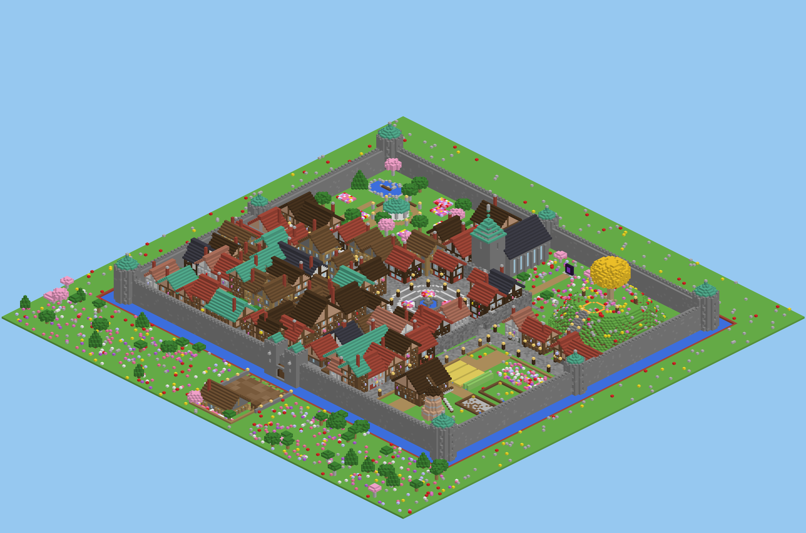
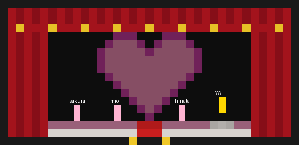

# 恋 ～結婚の試練～（Minecraft データパック）

シナリオ「恋 結婚の試練」を、そのまま遊べるデータパックにしたものです。
ヨーロッパの古い町（城壁・外堀・跳ね橋・木組みの家・中央広場・教会・丘の伝説の木・農場・公園）を `/function rufu:setup` 一発で自動建築し、
4つの理不尽な試練 → 結婚式 → エンディング → ドッキリ大成功 までを、るふ（GM）のリモコン操作で1段階ずつ進めます。



## 対応バージョン

- **Minecraft Java Edition 26.3**（データパック形式 121）
  - ポプラの木・マネキン（NPC）・ハッピーガストを使うため、これより古いバージョンでは動きません。

## 導入

1. ワールド作成（チートON）。おすすめは **スーパーフラット → プリセット「虚空（The Void）」**。普通のワールドでもOK（建築範囲を整地します）。
2. `dist/rufu_kekkon.zip` をワールドの `datapacks` フォルダに入れて `/reload`。
3. `/function rufu:setup` … 町を建設（数秒〜数十秒。上部に進捗バー）。
4. `/function rufu:menu` … 実行した人がGM（るふ）になり、リモコン3本とメニューが出ます。
5. チャットのメニューで各プレイヤーを **[主人公]**（1人）／**[助っ人]**（2人）に設定。
   - ひとりでテストする場合は、GMのまま自分を[主人公]にしてもOK。
6. **[✅ 準備完了 → 選択ホールへ（start）]** をクリック（または `/function rufu:start`）。
   → 全員が黒い「選択ホール」に集まり、**段階0（待機）** になります。るふの説明・雑談タイム。
7. 緑のリモコン「▶ 次へ」でタイトル → ヒロイン選択が始まります。

## るふの手元操作

| アイテム | できること |
|---|---|
| 緑のリモコン「▶ 次へ」 | 次の段階を実行（セリフ、試練開始、屋根の爆発など） |
| 黄色のリモコン「↻ もう一回」 | 今の段階をもう一度（言い直し・タイミング取り直し） |
| 赤のリモコン「⟲ やり直し」 | 今のミッションを最初から（トラブル用。リトライ回数は増えない） |

- るふの画面下（アクションバー）にだけ「今：〇〇　次：〇〇」と状態が出ます。
- クリア判定・失敗判定・タイマーは自動。クリアしても、次は「次へ」を押すまで始まりません。
- 試練中は「次へ」がロックされます（クリアで解除）。
- スペクテイターではアイテムを使えないので、`/function rufu:gm/panel` のチャットボタン（次へ／もう一回／やり直し／強制スキップ／段階一覧ジャンプ）を使ってください。

## プロローグ：4人選択（結局1人しか選べない）



- **段階0（start直後）**：黒い壁の選択ホール。奥の壁に大きなピンクのハート、赤いじゅうたん（両側に金のライン）、左右に赤いカーテン。
  台の上に さくら（清楚系／生徒会長）・みお（クール系／弓道部）・ひなた（元気系／幼なじみ）・？？？（★おすすめ★、金の台の上で光っている）。
  ？？？は一番近いプレイヤーをずっと見ています。参加者はじゅうたんの手前でステージを向いて立っています。
- **段階1（次へ1回目）**：大きく「恋」「～結婚の試練～」、アメジストの音とハート。4人の頭上に「この子にする」（？？？だけ金色の「★この子にする★」）。押せるのは主人公だけ。
  - 可愛い3人を選ぶ → その子に本物の雷＋煙、肩書きが「近日実装」に。？？？が一歩近づいて心音。
    1回目「……」／2回目「その子、まだいないよ？」／3回目 画面が真っ暗（暗闇＋盲目＋エルダーガーディアンの呪い音）→明けると？？？が目の前に／4回目以降「ねえ、私にしなよ」
  - ？？？を選ぶ → 「知ってた♡」ハートとレベルアップ音。光が消えて肩書き「名前をつけてね」、看板が消える。主人公に名札と経験値3レベル、ホールの金床がキラキラ。
  - 金床で名札に名前を書いて、それを持って？？？を右クリック → 頭上の名前が変わり「〇〇……いい名前♡」とチャイム。3人は消える。
    名札なしで話しかけると「金床で名札に名前を書いて、私に使って」。
  - 名前をつけなかった場合は自動で「ゆめりあ」。つけた名前はセリフの名前表示・好感度バー・スタッフロールにも使われます。
- **段階2（次へ2回目）**：ヒロインがステージ中央に出て主人公を向き、鐘の音と一緒に「結婚したければ、4つの試練をクリアして。」。
  前に大きなルール看板、画面上に「〇〇の好感度」バー（満タン）。ここで止まり、次の「次へ」で試練1へ。

## 全40段階

| # | 内容 |
|---|---|
| 1–2 | タイトル → ヒロイン選択（名前つけ）／試練の宣言＋ルール看板 |
| 3 | 試練1説明（主人公の家へ移動） |
| 4–5 | **試練1「私より早く広場に来て」**（45秒）→ 評価D「理由：私より遅い」 |
| 6–9 | **試練2「結婚式のごちそうを作って」**（4分・担当発表・2分で担当交代）→「やっぱパンだけでよかった」→ 評価 |
| 10–14 | **試練3「結婚報告パレード」**（2〜5ブロック維持）→「この道じゃない方がよかった」→ 夜の裏通りで2周目 → 評価 → 丘へ |
| 15–19 | **試練4「指輪を取り返して告白」**（キツネ→光る円→逃げる看板）→「やっぱりなかったことに」空が巻き戻る → 2回目（キツネ3匹）→ 総合評価D「理由：顔」 |
| 20–30 | 結婚式：鐘と結婚行進曲／神父の誓い／「誓います♡」と花火／誓いのキス／**「ちょっと待ったーー！！」**／屋根爆発・元彼レオンがエリトラで乱入／好感度0／雷雨／豚でのろのろ逃走→ネザーゲート爆破 |
| 31–40 | 神父「ハァン……」／返品された指輪／スタッフロール「END ノーマルエンド：返品」／アップデートのお知らせ（さくら・みお・ひなた）／主人公が選ぶ／3人ともヒロインに変身／ハッピーガストで元彼／「じゃ、全員もらってくわ」／**ドッキリ大成功！ 仕掛け人：Rufu** |

## ルールの実装

- **3人全員クリアが条件**：1人でも失敗・死亡 → 3秒後に3人そろってその試練の最初から（自動）。
- **好感度**：ボスバー。各試練開始時100。落とし穴・既読無視・割り込みで×などで減り、0で失敗。
  花ばさみで町の花をつんでヒロインに右クリック → 好感度+20（各試練1回）。
- **制限時間**：ボスバーに残り時間。
- **リトライ回数**：右のサイドバーに表示、最後の総合評価で発表。
- **ダメージあり**：ゾンビ・スケルトン・クリーパー・ドラウンド・金床・雷は本当に痛い。死んだら失敗。
- **持ち物は消えない**：keep_inventory。やり直し時はその試練で集めた物だけ没収。
- **主人公だけの理不尽**：30秒おきに目の前に「今なにしてる？」看板（5秒以内に右クリックしないと−10）、
  試練中に1回「私のいいところ3つ言って」などの割り込み（助っ人がチャットの〇×で判定、±10）。

## 試練の中身（実装）

- **試練1**：主人公の家 → 落とし穴の道（踏むと溶岩。やり直すたびに場所が変わる）→ 外堀と跳ね橋（ランダムに数秒だけ下りる。
  橋用ブロックを樽から取って自分で橋をかけ、横の通用口から入るのもアリ）→ 木組みの家の屋根パルクール（落ちると路地裏にゾンビ）
  → 崩れた城壁（ツルハシは1本だけ。ひび割れた石レンガだけ壊せる）→ 噴水。ゴール直前でヒロインが後ろから追い抜きます。
- **試練2**：頭の上に担当表示（パン／ケーキ／お肉）。農場に育ちきった小麦・サトウキビ・牛3頭・豚・燃料入りかまど・バケツ3つと卵のチェスト。
  万能ナイフ支給。2分で担当シャッフル。担当以外が渡すと失敗。
- **試練3**：ヒロインが急に止まる・走る・Uターン・後ろ歩き・路地に曲がる。画面下に距離ゲージ、共通アウトゲージ。
  ゾンビの群れ・クリーパー・屋根の上のスケルトン・金床、夜は雷も。
- **試練4**：2人以上で囲むとキツネが止まる → 叩くと指輪を落とす。主人公が指輪を持って3人で光る円へ → 逃げる「結婚してください」看板を
  助っ人2人で押さえて主人公が右クリック。宝箱3つ（スコップで×印を掘る：スイートベリーでキツネを誘える、花、ハズレ）。
  2回目は偽物キツネ（叩くと爆発）が混ざります。

## フォルダ構成

```
dist/rufu_kekkon.zip      ← これをワールドの datapacks に入れる
datapack/rufu_kekkon/     ← 展開済みのデータパック（中身は zip と同じ）
tools/                    ← 生成スクリプト（Python）
  build.py                  データパックを生成
  validate.py               26.3 のコマンド定義に照らして全コマンドを検証
  town.py / layout.py       町の建築（ボクセル→fillコマンドに圧縮）
  system.py / mission.py    段階エンジン・HUD・リモコン・失敗/やり直し
  m1.py〜m4.py / wed.py     各試練・結婚式・エンディング
docs/                     ← 町のプレビュー画像
```

再生成：`python3 tools/build.py && python3 tools/validate.py`

## 注意

- 選択ホールは町の南西の外（X 14〜50 / Z 220〜254）に建ちます。
- 建築範囲は X 8〜247 / Z 16〜255 / Y 48〜191（常時読み込み）。この範囲の既存ブロックは上書きされます。
- 町は Y=64 の地面の上に建ちます。
- ゲームルール（keep_inventory, advance_time=false, spawn_mobs=false, mob_griefing=false, ネザーゲート無効 など）をセットアップ時に変更します。
- 検証は 26.3 の公式コマンドツリーに対する静的チェック（全約5万コマンド・エラー0）です。実機での最終確認をおすすめします。
